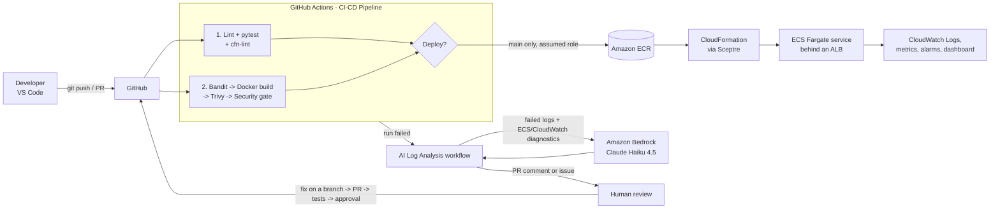

# Architecture

## Big picture

## Components

| Part | Service | Defined in |
|---|---|---|
| Source code and pipeline | GitHub, GitHub Actions | `.github/workflows/` |
| App | Python Flask + gunicorn in Docker | `app/`, `Dockerfile` |
| Image registry | Amazon ECR (immutable tags, scan on push) | `infra/templates/ecr.yaml` |
| Network | VPC, 2 public subnets, internet gateway | `infra/templates/network.yaml` |
| Runtime | Amazon ECS on Fargate + Application Load Balancer | `infra/templates/ecs-app.yaml` |
| Access from GitHub | CI user that can only assume 2 roles, + CloudFormation service role | `infra/templates/github-access.yaml` |
| Monitoring | CloudWatch Logs, Container Insights, alarms, dashboard, SNS email | `infra/templates/monitoring.yaml` |
| AI troubleshooting | Amazon Bedrock (Converse API) | `scripts/ai_log_analyzer.py`, `.github/workflows/ai-log-analysis.yml` |
| Infrastructure tool | AWS CloudFormation managed with Sceptre | `infra/config/` |

## Stacks (created in this order)

| Sceptre config | CloudFormation stack | Who launches it |
|---|---|---|
| `dev/network.yaml` | `secure-cicd-dev-network` | You, once |
| `dev/ecr.yaml` | `secure-cicd-dev-ecr` | You, once (pulled in by github-access) |
| `dev/github-access.yaml` | `secure-cicd-dev-github-access` | You, once |
| `dev/app.yaml` | `secure-cicd-dev-app` | The pipeline, on every merge to main |
| `dev/monitoring.yaml` | `secure-cicd-dev-monitoring` | You, after the first deploy |

## Security design

- **Minimal keys, short-lived sessions.** The AWS organization blocks OIDC identity providers, so GitHub uses one IAM user (`secure-cicd-github-ci`) that has no permissions except assuming the two pipeline roles. Its keys are stored as secrets in the GitHub environment `aws-main`, which only the `main` branch can use, so pull requests never see them. Every job runs with 1-hour role credentials. Rotate the keys regularly (see the runbook).
- **Three separate roles, least privilege:**
  - `secure-cicd-github-ai-analysis` - can only call Bedrock.
  - `secure-cicd-github-deploy` - can push to one ECR repo and update one CloudFormation stack.
  - `secure-cicd-dev-cfn-service` - used by CloudFormation itself to build ECS resources; can only create IAM roles named `secure-cicd-dev-*`.
- **Scan what you ship.** The image is built once, scanned by Trivy, saved, and that same image is pushed and deployed. ECR tags are immutable.
- **Fixed rules decide, AI advises.** The security gate (`scripts/security_gate.py`) uses plain rules. The AI only explains failures and suggests fixes.
- **Human in control.** AI output goes to a PR comment or an issue. Code changes still need a pull request, passing tests and scans, and an approving review (branch protection + CODEOWNERS).
- **Safe AI input.** Logs are redacted (AWS keys, tokens, passwords, account IDs) before they go to Bedrock, and the prompt treats logs as untrusted data.
- **Containers:** run as a non-root user; only the load balancer can reach them; ECS deployment circuit breaker rolls back a bad release automatically.

## Cost (eu-north-1, approximate)

While the app stack is running: about **$1 per day** (load balancer, one 0.25 vCPU Fargate task, public IPv4 addresses). Bedrock calls cost a fraction of a cent each. Delete the stacks when you are not using them (see `docs/runbook.md`).
